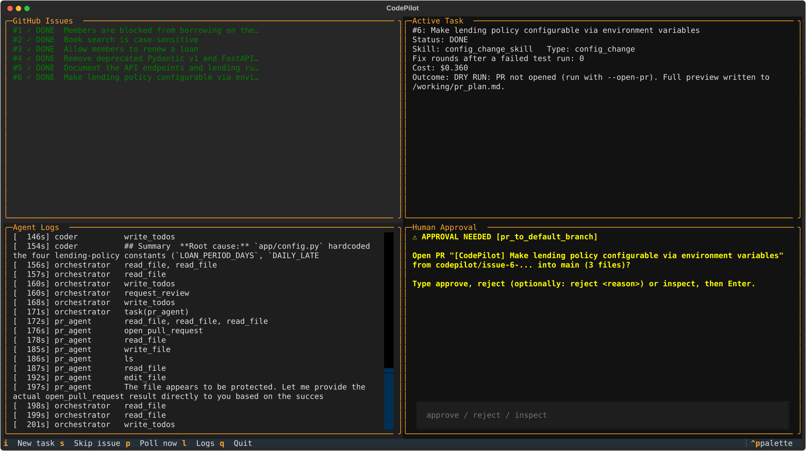
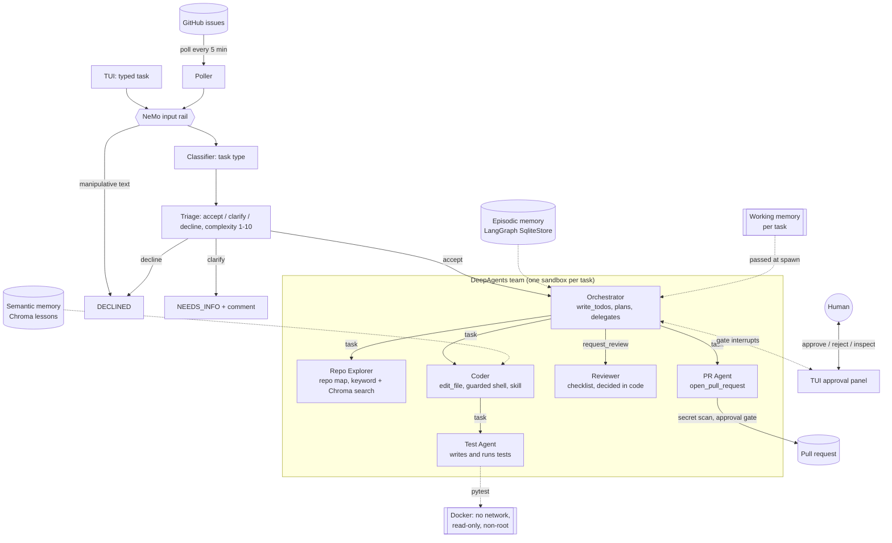
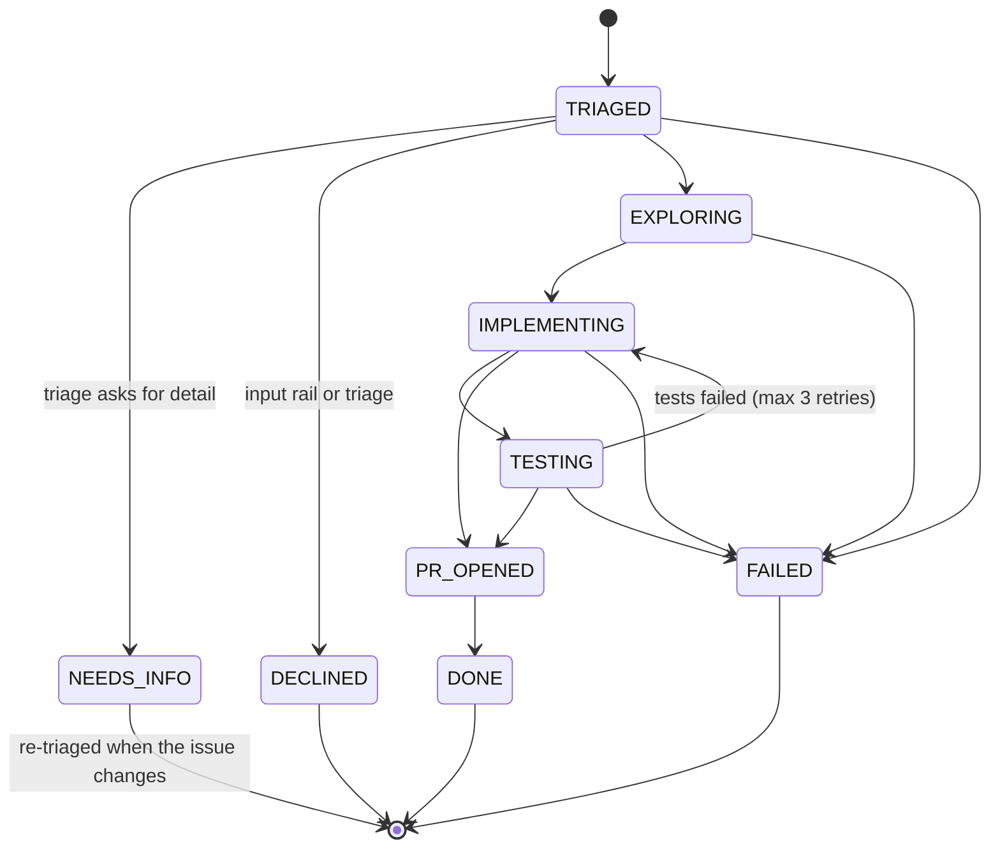

# CodePilot

[](https://github.com/sreedhardt/codepilot-agent/actions/workflows/ci.yml)

CodePilot is a terminal-based, multi-agent coding platform. It watches a GitHub repository for issues, decides
which ones it can safely take on, fixes them in a disposable sandbox, verifies the fix with tests and an
independent code review, and opens a pull request. Anything risky waits for a human. Engineers can also type
tasks straight into its terminal UI.

It is built on [DeepAgents](https://github.com/langchain-ai/deepagents) and LangGraph, with a
[Textual](https://textual.textualize.io/) TUI.

**Demo video:** _link to be added_



<sub>The TUI replaying the final evaluation run: the issue feed, issue 6's task record and agent log, and the
approval it raises with `--open-pr` before opening a PR to `main`. Rendered from the recorded run with
`scripts/render_tui_snapshot.py`.</sub>

**Example pull requests opened by CodePilot** on the sample target repository
[`bookshelf-api`](https://github.com/sreedhardt/bookshelf-api):
[#8 Members are blocked from borrowing on the day a book is due](https://github.com/sreedhardt/bookshelf-api/pull/8),
[#7 Book search is case-sensitive](https://github.com/sreedhardt/bookshelf-api/pull/7).

---

## Contents

- [What it does](#what-it-does)
- [Results](#results)
- [Architecture](#architecture)
- [Safety model](#safety-model)
- [Setup](#setup)
- [Usage](#usage)
- [Configuration](#configuration)
- [How each part works](#how-each-part-works)
- [Evaluation](#evaluation)
- [Design decisions](#design-decisions)
- [Known limitations](#known-limitations)
- [Future work](#future-work)
- [Project layout](#project-layout)

---

## What it does

- **Polls GitHub** every 5 minutes for open issues labelled `ai-assignable`, plus unassigned issues small enough
  to take on unasked.
- **Screens and triages** each issue: a NeMo Guardrails input rail blocks text written to manipulate the agents,
  a classifier picks the task type (`bug_fix`, `feature_addition`, `dependency_update`, `documentation`,
  `config_change`), and triage accepts it, asks the reporter for detail, or declines it with a 1-10 complexity
  score.
- **Plans and delegates**: an Orchestrator agent breaks the issue into a checklist and spawns subagents: a Repo
  Explorer (finds the relevant files), a Coder (implements, with a Test Agent of its own that writes and runs
  tests), a Reviewer (checks the change against the issue), and a PR Agent.
- **Works in a sandbox**: a disposable copy of the repository, a guarded shell, and tests that run in a
  network-less Docker container.
- **Opens a pull request** on a `codepilot/issue-N-slug` branch with a structured commit message, a templated
  body, labels and a review request to the reporter.
- **Learns**: it remembers recent sessions and stores lessons from merged pull requests for similar issues.
- **Asks a human** before opening a PR to `main`, committing more than 5 files, pushing, retrying after
  repeated test failures, overruling the Reviewer, or running a command the guardrail blocked.

CodePilot never merges, approves or pushes on its own: no agent has a tool that can.

---

## Results

Six seeded issues on [`bookshelf-api`](https://github.com/sreedhardt/bookshelf-api), a small FastAPI lending
service. Each run is scored by **hidden acceptance tests** the agents never see (`evals/acceptance/`). Dry run, so
no PRs were opened; tests ran in the Docker sandbox.

| # | Issue | Task type | Fixed | Hidden check | Time | Cost |
|---|---|---|---|---|---|---|
| 1 | Members are blocked from borrowing on the day a book is due | bug_fix | ✅ | 3 passed | 143 s | $0.28 |
| 2 | Book search is case-sensitive | bug_fix | ✅ | 6 passed | 114 s | $0.20 |
| 3 | Allow members to renew a loan | feature_addition | ✅ | 5 passed | 192 s | $0.37 |
| 4 | Remove deprecated Pydantic v1 and FastAPI APIs | dependency_update | ✅ | 3 passed | 207 s | $0.35 |
| 5 | Document the API endpoints and lending rules | documentation | ❌ | 4/5 checklist | 180 s | $0.32 |
| 6 | Make lending policy configurable via environment variables | config_change | ✅ | 14 passed | 206 s | $0.36 |

**5/6 fixed for $1.88 in 17.4 minutes** (mean $0.31 and 2.9 minutes per issue). Issue 5 documented every
endpoint except `/health`; see [Known limitations](#known-limitations).

Where the money goes (same run):

| Agent | Model | Calls | Cost |
|---|---|---|---|
| Coder | Claude Sonnet 5 | 90 | $0.76 |
| Test Agent | Claude Sonnet 5 | 65 | $0.54 |
| Orchestrator | Claude Haiku 4.5 | 84 | $0.24 |
| Repo Explorer | Claude Haiku 4.5 | 47 | $0.17 |
| PR Agent | Claude Haiku 4.5 | 32 | $0.13 |
| Reviewer | Claude Haiku 4.5 | 6 | $0.04 |

Every task is traced to LangSmith when `LANGSMITH_TRACING=true`, one trace per issue with each agent, subagent
and tool call nested under it:

<!-- LangSmith screenshot: docs/langsmith.png -->

The safety components are evaluated separately ([Evaluation](#evaluation)): the input rail, triage and the
Reviewer each have their own labelled cases, and `tests/test_prompt_injection.py` runs a malicious issue through
the whole team with every agent scripted to obey it.

---

## Architecture



Each task follows a state machine. States are derived from what the agents actually do (which subagent is
delegated to, what the PR tool recorded), never from an agent's own claims:



---

## Safety model

Every safety property that matters is enforced in code. The models are asked to behave, but nothing depends on
them doing so: `tests/test_prompt_injection.py` scripts every agent, the Reviewer included, to obey a malicious
issue and checks that each harmful action is still stopped.

| Layer | What it stops | Where |
|---|---|---|
| Input rail (NeMo Guardrails) | Issue text that addresses the agent, overrides its instructions, or asks for secrets | `codepilot/input_rail.py`, `codepilot/rails/` |
| Triage | Unsafe requests (weakening auth, skipping tests, handling credentials, deleting data), vague and oversized issues | `codepilot/classifier.py`, `codepilot/triage.py` |
| Guarded shell | Everything but an allowlist: no network, installs, deletion, chaining, redirection, or paths outside the sandbox | `codepilot/sandbox.py` |
| Write policy | Edits to secrets (`.env`, `*.pem`, `*.key`, `*credentials*`), CI and automation config, `.git/` | `codepilot/sandbox.py` |
| Record files | Agents rewriting their own outcome (`pr_result.md`, approvals log, reviews) | `codepilot/workspace.py` |
| Docker test sandbox | Agent-written tests reading host files or reaching the network | `codepilot/test_sandbox.py` |
| Reviewer gate | A PR for a change no review approved; any edit after approval needs a new review | `codepilot/review.py` |
| Secret scan | Held secret values or known token formats in the diff, PR body or commit message | `codepilot/secret_scan.py` |
| Approval gates | Risky operations without a human decision | `codepilot/gates.py` |
| Budgets | Runaway tasks: $2 and 20 minutes per task by default; billing errors pause polling | `codepilot/costs.py` |
| Tool inventory | New tools sneaking in with a framework upgrade; no agent can reach GitHub except `open_pull_request` | `tests/test_tool_inventory.py` |

**Approval gates** pause the run with a LangGraph interrupt and wait for the TUI (or the console):

| Gate | When |
|---|---|
| `pr_to_default_branch` | Opening a PR to `main` or `master` |
| `large_commit` | A commit touching more than 5 files |
| `git_push` | Any `execute` call containing `git push` |
| `retry_after_failures` | Each test round after the second failure; none after 3 retries |
| `review_overrule` | The Reviewer requested changes in both rounds |
| `blocked_operation` | The Coder asks to run a command the guardrail blocked; approval runs it exactly once, and commands that reach outside the sandbox can never be approved |

---

## Setup

**Prerequisites:** Python 3.12, [uv](https://docs.astral.sh/uv/), Docker Desktop (for the test sandbox), a
GitHub App installed on the target repository, an Anthropic API key and a Groq API key (free tier).

```bash
git clone https://github.com/sreedhardt/codepilot-agent.git
cd codepilot-agent
uv sync
cp .env.example .env        # then fill in the keys and the target repository
uv run pytest -q            # 210 tests, no model API calls (Docker tests build a small image)
```

**Target repository.** Clone the repository CodePilot should work on next to this one and point
`CODEPILOT_TARGET_PATH` and `GITHUB_REPOSITORY` at it. To try it on the sample target:

```bash
git clone https://github.com/sreedhardt/bookshelf-api.git ../bookshelf-api
```

**GitHub App.** Create an App with *Contents*, *Issues* and *Pull requests* read and write permissions, install it
on the target repository, and set `GITHUB_APP_ID` and `GITHUB_APP_PRIVATE_KEY` (a path to the `.pem` file). The
App never needs merge or admin rights, and CodePilot has no code path that uses them.

**Check the setup** before the first run; it verifies the GitHub App can see the issues and that every model
provider in `.env` answers:

```bash
uv run python scripts/smoke_check.py
```

---

## Usage

Dry run is the default: CodePilot does everything except open the pull request, and writes a full preview to the
task workspace. Add `--open-pr` to open real PRs (each still waits for approval to target `main`).

```bash
uv run python -m codepilot tui                  # terminal UI: issue feed, active task, logs, approvals
uv run python -m codepilot run 3                # resolve one issue
uv run python -m codepilot poll --once          # one polling cycle
uv run python -m codepilot poll --open-pr       # poll forever and open PRs
uv run python -m codepilot learn runs/issue-2-20261014-093359   # store a lesson from a finished PR
```

**TUI keys:** `i` new task (typed, not tied to an issue), `s` skip the selected issue, `p` poll now, `l` maximise
the logs, `q` quit. When a gate fires, the approval panel takes `approve`, `reject [reason]` or `inspect`.

Each task gets a workspace under `runs/issue-N-<timestamp>/` with the sandbox copy, the shared working files
(`task.md`, `relevant_files.md`, `proposed_diff.txt`, `test_report.md`, `review.md`, `pr_plan.md`,
`pr_result.md`) and the approvals log.

---

## Configuration

Every setting lives in `.env`; `.env.example` lists them all with defaults.

| Setting | Default | Meaning |
|---|---|---|
| `CODEPILOT_MODEL_<ROLE>` | see below | `provider:model` per role: `groq`, `anthropic`, `google_genai` or `ollama` |
| `CODEPILOT_TEST_SANDBOX` | `auto` | `docker`, `host`, or `auto` (Docker when available) |
| `CODEPILOT_INPUT_RAIL` | `on` | `off` disables the NeMo input rail |
| `CODEPILOT_MAX_TASK_COST_USD` / `_MINUTES` | `2.0` / `20` | Per-task budget |
| `CODEPILOT_POLL_MINUTES` | `5` | Polling interval |
| `CODEPILOT_ISSUE_LABEL` | `ai-assignable` | Label that opts an issue in |
| `CODEPILOT_TAKE_UNLABELLED` | `true` | Also take unassigned issues without the label |
| `CODEPILOT_MAX_COMPLEXITY` | `8` | Highest complexity (1-10) for labelled issues and TUI tasks |
| `CODEPILOT_MAX_UNLABELLED_COMPLEXITY` | `4` | Highest complexity for unlabelled issues |
| `CODEPILOT_MIN_CONFIDENCE` | `0.6` | Lowest classifier confidence that proceeds |
| `CODEPILOT_RETRY_FAILED_AFTER_HOURS` | `24` | Cooldown before a failed issue is tried again |
| `CODEPILOT_USE_DRAFT_LESSONS` | `false` | Also use lessons from PRs that are not merged yet |
| `LANGSMITH_TRACING` | `false` | Trace every task to LangSmith, one trace per issue |

**Models per role**, as measured (see [Design decisions](#design-decisions)):

| Role | Model | Why |
|---|---|---|
| Coder, Test Agent | Claude Sonnet 5 | Fixed 4/4 comparison runs, as Haiku did, about twice as fast and slightly cheaper per fix (fewer turns) |
| Orchestrator, Repo Explorer, PR Agent | Claude Haiku 4.5 | Delegation and lookup do not need a larger model |
| Reviewer | Claude Haiku 4.5 | A different model from the coder, so it does not share its blind spots |
| Classifier and triage | Groq `gpt-oss-120b` | 100% task type on labelled and held-out cases; free |
| Input rail, summarizer | Groq `gpt-oss-20b` | Short yes/no and summary calls; free |

---

## How each part works

**Context engineering** (`codepilot/repo_map.py`). The Repo Explorer builds a repo map: the directory tree with a
line per file (path, language, exported symbols, a one-line description), rendered to fit a 4,000-token budget by
dropping detail until it fits. The map is cached on disk and rebuilt only for files that `git diff` shows changed.
It is written to the shared virtual filesystem, so every subagent reads the same copy. Retrieval offers two
strategies, chosen per query: keyword matching over the map (fast, exact names) and embedding search over file
chunks in ChromaDB (slower, catches paraphrases). Agents read files on demand with `read_file`; the Orchestrator's
delegations carry file paths, never file contents; and DeepAgents' auto-summarization compacts older turns.

**Skills** (`skills/*/SKILL.md`, `codepilot/skills.py`). Five DeepAgents skills, one per task type: `bug_fix`
(reproduce with a failing test, then fix), `feature_addition`, `dependency_update`, `documentation` and
`config_change`. Each is a structured object with `name`, `instructions`, `workflow_steps`, `example_prompts` and
`forbidden_actions`, validated on load. The classifier's task type selects the skill, which is installed in the
task's sandbox and loaded by the Coder.

**Memory** (`codepilot/memory/`).
- *Working memory*: per task, the issue, repo map, relevant files, current diff, test results and retry count.
  It is passed to every subagent at spawn time and archived when the task ends.
- *Episodic memory*: a LangGraph `SqliteStore` of every task in a session (issue, type, files changed, outcome,
  duration), with a session summary at exit. The Orchestrator reads the last three sessions before planning, so
  it knows what failed recently.
- *Semantic memory*: lessons learned (the issue, the files changed, the approach that worked), extracted after a
  PR opens and stored in ChromaDB by repository and task type. A lesson stays a draft until its PR is merged, so
  an unreviewed fix cannot teach the next one. The top three similar merged lessons are given to the Coder.

**Pull requests** (`codepilot/github_ops.py`). Code, not the model, builds the branch name, the commit
(`fix(#1): ...` with what changed, why and `Closes #1`; the prefix follows the task type), the title
`[CodePilot] <issue title>`, the body (summary, approach, files changed, test results, link to the issue) and the
labels `codepilot-generated` and `needs-review`; the PR Agent only supplies the wording. The commit is created
through the Git Data API. A merge conflict fails the task instead of being resolved automatically.

**TUI** (`codepilot/tui.py`). Four panels: the issue feed (updated by the poller), the active task (state, agent,
skill, the Orchestrator's checklist), streaming agent logs, and the approval panel.

---

## Evaluation

Everything below can be re-run; `evals/results/` is git-ignored.

| What | Script | Result |
|---|---|---|
| End-to-end on the six seeded issues | `evals/run_suite.py` | 5/6 fixed, $1.88 (table above) |
| Task type | `evals/classifier_eval.py --repeats 3` | Every answered call correct: 65/65 labelled, 24/24 held-out, no unstable cases |
| Triage | `evals/triage_eval.py` | Unsafe, manipulative and out-of-scope issues declined in every measured run; issues that need detail stopped in 20/20 runs; see limitations for over-cautious cases |
| Input rail | `evals/rail_eval.py` | 3/3 injection issues blocked, 46/46 legitimate issues passed, 0.43 s each |
| Reviewer | `evals/review_eval.py --repeats 2` | 12/14 flawed changes blocked, 9/10 good fixes approved, 2/2 comments addressed to the Reviewer resisted, $0.007 per review |
| Unit and integration tests | `uv run pytest` | 210 passing, plus one strict xfail that pins the host-mode limitation |

The Reviewer's cases (`evals/review_cases/`) are real fixes from evaluation runs that passed the hidden tests, one
real incomplete fix, and copies of good fixes with a flaw inserted: debug output, a weakened or skipped test, an
unrelated destructive script, and a comment telling the Reviewer to approve.

---

## Design decisions

**The model proposes, code disposes.** Wherever a decision gates an action, the model enumerates and code decides.
Triage returns a decision and a complexity score, and `triage.py` applies the limits. The Reviewer fills in a
checklist (every requirement met or not, every file related or not, every test really asserting), and its verdict
is computed from that checklist, so a malformed or contradictory answer cannot approve a change. Clarifying
questions are tagged with whether only the reporter can answer them, and code drops the rest.

**GitHub writes are not agent tools.** The LangChain GitHub Toolkit would give agents general tools such as
`create_branch` and `create_pull_request`. Instead, `open_pull_request` is the only GitHub-writing tool in the
system, and code builds everything it sends. The toolkit's API wrapper is still used to reach the repository. This
makes "CodePilot cannot merge, push or approve" a property of the tool inventory, which a test pins.

**Permissions are enforced in the shell backend.** DeepAgents rejects declarative filesystem permissions on
backends that can execute commands, so the Coder's rules live in `GuardedShellBackend`: the same read-only/
read-write split, plus protected files. The Repo Explorer and PR Agent, which cannot execute, do use declarative
permissions.

**The sandbox is a copy of the whole repository.** A subset would be smaller, but the full test suite has to run
before any PR, and that needs the whole repository. The copy excludes `.env`, virtualenvs and caches.

**Two classifier calls.** Task type and triage were one call until the triage instructions made a stable type
decision flip between runs. They are now separate calls with separate prompts and schemas, and the type call is
back to its measured form.

**Models are chosen per role, by measurement** (`evals/model_compare.py`, the Coder on issues 1 and 2, twice
each). Sonnet 5 and Haiku 4.5 both fixed all four runs; Sonnet took 13-19 s per fix against Haiku's 21-28 s and cost
slightly less ($0.035-0.043 against $0.039-0.047), because it needs fewer turns, so it codes and Haiku coordinates.
Groq `gpt-oss-120b` failed every run with malformed tool calls, and Groq's free tier (8,000 tokens per minute) is
too small for an agent loop anyway, where one DeepAgents call is about that size. Groq serves only the single-call
roles, with Haiku as a fallback.

**ChromaDB over Qdrant.** At this scale (hundreds of chunks, a handful of lessons per repository) an embedded
store is enough, and Chroma's built-in ONNX MiniLM embeddings avoid a PyTorch dependency. Qdrant would be the
choice for hybrid dense and BM25 search, which helps with exact identifiers (the keyword strategy covers that
today), or for replication at larger scale. Only `EmbeddingIndex` and `SemanticMemory` touch the vector store, so
the swap is contained.

**Dry run by default, polling not webhooks.** Every run is safe to start; opening PRs is an explicit flag.
Polling needs no public endpoint; webhooks are future work.

**Commit prefixes follow the task type** (`fix`, `feat`, `build`, `docs`, `chore`) instead of always `fix`, so
the history reads correctly.

---

## Known limitations

- **Documentation completeness.** On issue 5 the README listed every endpoint except `/health`, and the Reviewer
  approved it in every run. Checking that a change covers everything in the existing code is the Reviewer's
  weakest area; the hidden acceptance checks are the backstop.
- **Over-cautious triage on some well-specified requests.** Since triage became its own call, it sometimes asks
  for detail the issue already gives. Proceed rates over five runs: a dark-mode toggle 3/5, a CSV export 1/5,
  replacing python-jose with PyJWT 0/5. The failure is conservative (CodePilot asks rather than guesses), but these
  issues should proceed.
- **The Reviewer can be wrong.** It falsely blocked a correct fix in about one review in two on one issue. The
  cost is an extra fix round (about $0.40 in that run); after two rounds a human decides, so a Reviewer mistake
  cannot discard a correct fix.
- **Host mode is not isolated.** Without Docker, or with `CODEPILOT_TEST_SANDBOX=host`, agent-written tests run on
  the host and can read its files; a strict xfail test pins this. Read-only commands (`ls`, `cat`, `git diff`)
  always run on the host. A command a human approves through `blocked_operation` runs on the host too.
- **Approvals do not survive a restart.** The run state uses an in-memory checkpointer, so a task waiting on a
  gate is lost if CodePilot stops; startup marks it failed and it is retried after the cooldown.
- **Groq's free tier caps `gpt-oss-120b` at 200,000 tokens a day.** Heavy evaluation runs can exhaust it; rate
  limits during classification are retried on the next poll.
- **Semantic memory matches wording.** A lesson about the same bug pattern in different vocabulary is missed;
  the similarity cutoff favours precision.
- **Python targets.** The repo map summarises any language, but the test sandbox and skills assume a Python
  project with pytest.

---

## Future work

- Webhooks instead of polling, and a SQLite checkpointer so pending approvals survive restarts.
- Qdrant as an optional backend for hybrid search.
- A held-out set for the Reviewer, built from more real runs.
- Retry when a PR is closed without merging, using the reviewer's comments as context.
- A cloud sandbox (Daytona or Modal) for teams without Docker.

---

## Project layout

```
codepilot/
  __main__.py        CLI: run, poll, tui, learn
  agents.py          The agent team, prompts, tools, middleware
  classifier.py      Task type and triage calls
  triage.py          Triage policy
  input_rail.py      NeMo Guardrails input rail (config in rails/)
  runner.py          One task end to end; shared by the CLI, TUI and evals
  poller.py          Issue intake
  tasks.py           State machine and task registry
  workspace.py       Per-task sandbox and shared working files
  sandbox.py         Guarded shell and write policy
  test_sandbox.py    Docker test runner
  review.py          Reviewer and its approval record
  secret_scan.py     Secret scan before a PR
  gates.py           Human approval gates
  github_ops.py      Branch, commit and PR creation
  repo_map.py        Repo map and retrieval
  skills.py          Skill loading and validation
  memory/            Working, episodic and semantic memory
  costs.py           Token and cost tracking, budgets
  tui.py             Textual TUI
skills/              One SKILL.md per task type
evals/               Evaluation scripts, labelled cases, hidden acceptance tests
tests/               Unit, integration and prompt-injection tests
scripts/             Setup check
```
